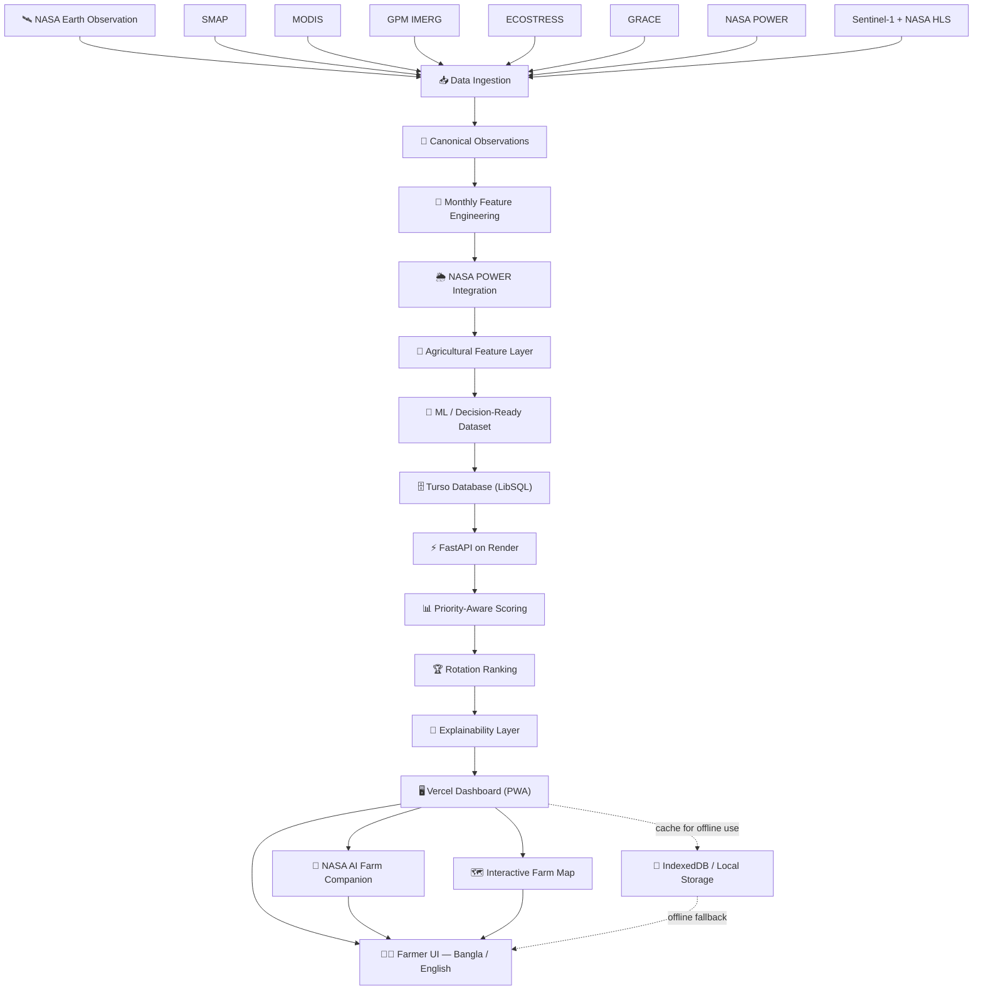
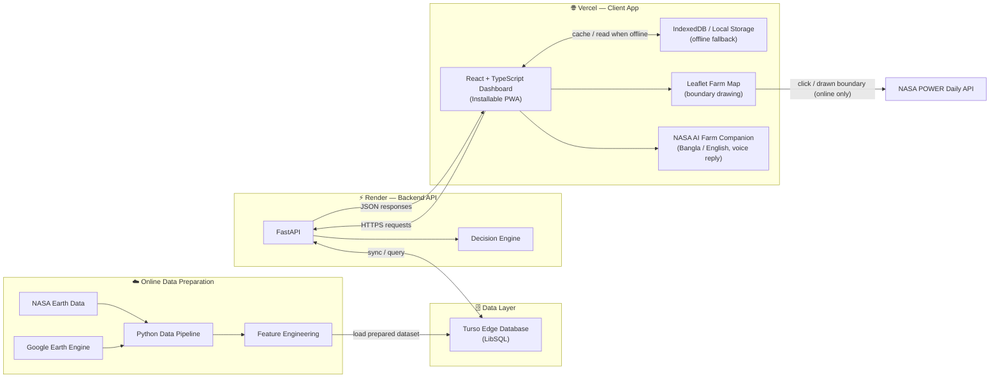
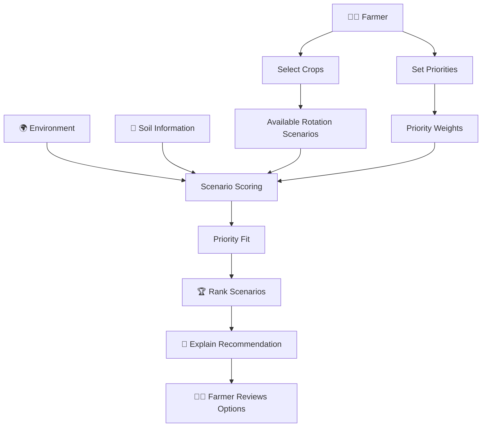
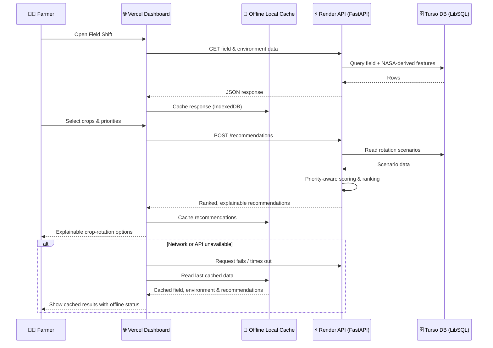
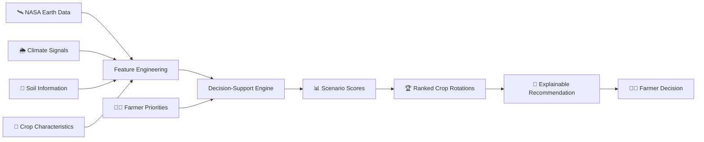

# 🌱 Field Shift

### NASA Space Apps Challenge 2026 — Adapting Farms with NASA Data

> **Real Earth data. Real farm decisions. A more resilient future.**


Field Shift is an **offline-first NASA Earth-observation decision-support system for climate-resilient crop rotation**.

It translates complex Earth-observation and agricultural signals into one plain-language question for farmers facing shifting rainfall, water stress, climate variability, and soil-health challenges:

> **Should I keep this crop, adjust my priorities, or shift my rotation?**

---

## 🌐 Live Deployments

| Layer | Platform | Role | Link |
|---|---|---|---|
| **Frontend** | [Vercel](https://vercel.com) | React + TypeScript farmer dashboard | [field-shift-five.vercel.app](https://field-shift-five.vercel.app/) |
| **Backend API** | [Render](https://render.com) | Hosted FastAPI decision engine | Render web service |
| **Database** | [Turso](https://turso.tech) | Hosted LibSQL — distributed SQLite at the edge | Turso database |
| **App release** | [GitHub Releases](https://github.com/Zishan-125/field-shift/releases) | Installable Progressive Web App (PWA) release | [Zishan-125/field-shift](https://github.com/Zishan-125/field-shift/releases) |

**Production data path:** Vercel Dashboard → Render FastAPI → Turso (LibSQL), with IndexedDB / Local Storage on the client as the offline fallback.

---

## 🛰️ NASA Space Apps Challenge 2026

**Challenge:** Adapting Farms with NASA Data

**Project:** Field Shift

**Focus Areas:**

-  Earth Observation
-  Climate-Resilient Agriculture
-  Water Conservation
-  Soil Health
-  Climate Resilience
-  Machine Learning
-  Decision Support
-  Offline-First Technology

---

## 🎯 The Idea

Farmers experience changing weather and field conditions long before those changes become easy to interpret from scientific datasets.

NASA already provides valuable Earth observations for:

- soil moisture
- vegetation condition
- precipitation
- land-surface temperature
- land-water storage
- environmental variability

The challenge is not simply collecting the data.

The challenge is **translating those signals into understandable agricultural decisions**.

Field Shift is designed to combine:

```text
NASA Earth observations
        +
Local field information
        +
Soil information
        +
Crop characteristics
        +
Farmer priorities
        ↓
Understandable field assessment
        +
Crop-rotation decision support
```

The system does not attempt to replace agronomists or make guaranteed yield predictions.

Instead, it helps farmers compare crop-rotation scenarios using transparent, priority-aware decision scores.

---

## 🌾 What Field Shift Does

Field Shift connects Earth observation data with farmer-centered decision support.

The system can:

-  Process NASA Earth-observation datasets
-  Analyze rainfall and precipitation signals
-  Analyze root-zone soil moisture
-  Monitor vegetation-condition indicators
-  Examine land-surface temperature
-  Incorporate land-water-storage signals
-  Incorporate soil information
-  Compare crop-rotation scenarios
-  Allow farmers to define their priorities
-  Rank rotation scenarios
-  Explain why a recommendation received its score
-  Run the farmer-facing decision layer offline
-  Separate online data preparation from offline decision support
-  🗺️ Let farmers explore any location on an interactive Leaflet map, draw a farmland boundary and view live **NASA POWER** telemetry
-  🤖 Answer farm questions through the **NASA AI Farm Companion**, in Bangla and English with voice replies
-  🌱 Show **ISRIC SoilGrids 2.0** soil information, labelled as modelled estimates
-  🌡️ Show **28 years of NASA satellite rain and heat exposure** per crop, with flood return periods and 2041–2060 climate projections
-  🛰️ Show what **Sentinel-1 and NASA HLS** satellites saw on demo fields in every Feni upazila (2016–2025)
-  🌾 Compare **14 crop-rotation plans** against the most common pattern farmers use today, with food produced and irrigation water needed
-  🎯 Support five farmer priorities: food production, water efficiency, soil protection, climate readiness and crop variety
-  📱 Install as a **Progressive Web App**, with an app release on GitHub

---

## 🏗️ System Architecture

Field Shift is intentionally divided into two major phases.

### ☁️ Phase 1 — Online Data Preparation

NASA Earth data and Google Earth Engine are used during the data-preparation stage.

```text
NASA Earth Data / Google Earth Engine
                │
                ├──────── SMAP
                │
                ├──────── MODIS
                │
                ├──────── GPM IMERG
                │
                ├──────── ECOSTRESS
                │
                └──────── GRACE
                │
                ▼
        Data Ingestion Layer
                │
                ▼
      Canonical Observations
                │
                ▼
        Monthly Features
                │
                ▼
   Agricultural Feature Layer
                │
                ├──────── NASA POWER
                │
                ├──────── Soil Data
                │
                └──────── Crop Data
                │
                ▼
       ML / Decision Dataset
```

### 📴 Phase 2 — Production Decision Support

After data preparation, the prepared dataset is loaded into Turso (LibSQL). The FastAPI decision engine on Render serves it to the Vercel-hosted dashboard, and the client caches results locally so the farmer-facing layer keeps working offline.

```text
              Prepared Dataset
                     │
                     ▼
        Turso (LibSQL, edge-hosted)
                     │
                     ▼
              FastAPI (Render)
                     │
          ┌──────────┴──────────┐
          │                     │
          ▼                     ▼
      Field Data          Recommendations
          │                     │
          │                     │
          └──────────┬──────────┘
                     ▼
             Field Shift Engine
                     │
                     ▼
             Farmer Priorities
                     │
                     ▼
          Crop Rotation Ranking
                     │
                     ▼
           Explainable Results
                     │
                     ▼
          Farmer Web Dashboard
```

---

## 🔄 Complete System Workflow

The complete Field Shift workflow, from NASA Earth observation to farmer decision support:



---

## 🧩 High-Level Architecture



---

## 🛰️ NASA Earth-Observation Data

The current ingestion pipeline has processed the following NASA datasets:

| Dataset | Signal | Current Status |
|---|---|---|
| SMAP | Root-zone soil moisture | ✅ Ingested |
| MODIS | NDVI / vegetation condition | ✅ Ingested |
| GPM IMERG | Precipitation | ✅ Ingested |
| ECOSTRESS | Land-surface temperature / thermal condition | ✅ Ingested |
| GRACE | Land-water-storage signal | ✅ Ingested |
| NASA POWER | Temperature, precipitation, wind speed and solar radiation | ✅ In the dashboard |
| NASA HLS | Green-crop signal on demo fields | ✅ In the dashboard |
| Sentinel-1 | Radar water detection on demo fields | ✅ In the dashboard |
| NASA-downscaled climate models | 2041–2060 projections (10 models, SSP2-4.5 and SSP5-8.5) | ✅ In the dashboard |
| ISRIC SoilGrids 2.0 | Modelled surface-soil properties | ✅ In the dashboard |

### Primary datasets

#### SMAP

**Signal:** Root-zone soil moisture

Used to provide information about water availability in the soil profile.

Dataset: `NASA/SMAP/SPL4SMGP/007`

#### MODIS

**Signal:** NDVI / vegetation condition

Used as a vegetation-condition indicator.

Dataset: `MODIS/061/MOD13Q1`

#### GPM IMERG

**Signal:** Precipitation

Used to characterize rainfall conditions.

#### ECOSTRESS

**Signal:** Land-surface temperature

Used to provide thermal-condition information and support environmental stress analysis.

#### GRACE

**Signal:** Land-water-storage variation

Used as a broader water-storage indicator.

Dataset: `NASA/GRACE/MASS_GRIDS_V04/LAND`

#### NASA POWER

NASA POWER is used in the broader feature-engineering pipeline for climate and weather variables.

Current parameters include:

```text
ALLSKY_SFC_SW_DWN
T2M
WS10M
T2M_MAX
T2M_MIN
```

The dashboard's live telemetry and Earth Observation Context panels use the NASA POWER Daily API:

```text
T2M                  Temperature (°C)
PRECTOTCORR          Precipitation (mm/day)
WS2M                 Wind speed at 2 metres (m/s)
ALLSKY_SFC_SW_DWN    Solar radiation (kWh/m²/day)
```

NASA POWER daily observations may have a publication delay. The dashboard shows the latest available observation, not instantaneous real-time weather.

#### NASA HLS and Sentinel-1

**Signal:** Green-crop signal (NASA HLS) and radar water detection (Sentinel-1)

Used to show what satellites saw on one demo field per Feni upazila (2016–2025) and to show the 2024 Fulgazi flood from space. These are weak phenology-based labels on demo fields, not surveyed farms.

#### NASA-downscaled climate models

**Signal:** 2041–2060 projections from 10 climate models under SSP2-4.5 (middle path) and SSP5-8.5 (high emissions)

Applied as changes to the observed 1998–2014 climate. They are possibilities under each emissions path, not forecasts.

#### ISRIC SoilGrids 2.0

**Signal:** Soil pH, organic carbon, clay, sand and silt

Modelled soil estimates used as context for rotation comparison. They are not direct field-measured soil samples.

---

## 📊 Data Pipeline

The data pipeline is designed around the following stages:

```text
NASA / GEE
    │
    ▼
Raw Earth Observation Data
    │
    ▼
Data Validation
    │
    ▼
Canonical Observations
    │
    ▼
Monthly Aggregation
    │
    ▼
NASA POWER Integration
    │
    ▼
Environmental Features
    │
    ▼
Agricultural Features
    │
    ▼
Crop / Soil Features
    │
    ▼
Scenario Generation
    │
    ▼
Decision / ML Dataset
```

Current pipeline structure:

```text
data-pipeline/
├── dags/
├── historical/
│   ├── ecostress/
│   ├── gpm/
│   ├── grace/
│   ├── modis/
│   └── smap/
│
├── output/
│   ├── canonical/
│   ├── crop/
│   ├── features/
│   ├── scenarios/
│   ├── soil/
│   └── validation/
│
├── scoring/
├── fetch_nasa_power.py
├── ingest_ecostress.py
├── ingest_gpm_rainfall.py
├── ingest_grace_fo.py
├── ingest_modis_ndvi.py
└── ingest_smap.py
```

---

## 🎯 Farmer-Priority Recommendation Engine

Field Shift allows the farmer to define the importance of different decision objectives.

### Current priorities

| Priority | Farmer-facing label | Default weight |
|---|---|---|
| 🍚 Food production | Grow more food | 30% |
| 💧 Water efficiency | More food per drop | 25% |
| 🌱 Soil health | Protect soil | 20% |
| ☀️ Climate resilience | Handle climate | 15% |
| 🌾 Crop diversity | More crop variety | 10% |

Farmers can pick a main goal, raise or lower any goal with `−` / `+`, and reset at any time.

The priority system allows the same rotation to receive a different ranking depending on the farmer's current priorities.

For each rotation:

```text
Priority Contribution = Factor Score × Farmer Weight
```

The final decision-support score is:

```text
Priority Fit = Food Contribution
             + Water-Efficiency Contribution
             + Soil Contribution
             + Climate Contribution
             + Diversity Contribution
```

For example:

```text
Food             rotation score × current weight  →  contribution
Water efficiency rotation score × current weight  →  contribution
Soil      rotation score × current weight  →  contribution
Climate   rotation score × current weight  →  contribution
Diversity rotation score × current weight  →  contribution
```

The frontend displays these contributions so the farmer can understand why a particular rotation ranked highly.

---

## 🔎 Explainability

Field Shift is designed to avoid presenting a recommendation as a black box.

Each recommendation can expose:

```text
Rotation
   ↓
Food score
   ↓
Water-efficiency score
   ↓
Soil score
   ↓
Climate score
   ↓
Diversity score
   ↓
Farmer priority weights
   ↓
Priority Fit
```

The interface is designed to answer:

> **Why was this crop rotation recommended?**

rather than only:

> *What was recommended?*

---

## 🌾 Crop Rotation Decision Flow



---

## 🧠 Machine Learning Layer

The project contains model modules for future / ongoing machine-learning integration:

```text
ml-models/
├── stress_risk_model.py
├── shift_score_model.py
└── yield_forecast_lstm.py
```

### Current model roles

| Model | Intended Role |
|---|---|
| Stress Risk Model | Environmental / field stress assessment |
| Shift Score Model | Crop-rotation / environmental shift scoring |
| Yield Forecast LSTM | Temporal yield forecasting |

The complete ML integration is not yet the sole production runtime path.

The current farmer-facing decision layer primarily uses the prepared local dataset and explainable priority-aware scoring system.

This distinction is intentional: a decision-support score should not be presented as a scientifically validated yield or profit prediction unless appropriate validation has been completed.

---

## 💻 Technology Stack

### Frontend

- React
- TypeScript
- Vite
- Tailwind CSS
- Leaflet (interactive farm map with boundary drawing)
- Responsive farmer-first UI
- Bangla / English interface
- Voice replies for the AI Farm Companion
- Installable PWA
- IndexedDB
- Local Storage
- Offline-first frontend architecture

### Backend

- Python
- FastAPI (hosted on Render)
- Turso — hosted LibSQL / distributed SQLite at the edge
- SQLite-compatible local database for development
- REST API
- Local decision-support services

### Data & Earth Observation

- NASA SMAP
- NASA MODIS
- NASA GPM IMERG
- NASA ECOSTRESS
- NASA GRACE
- NASA POWER
- NASA HLS
- Sentinel-1
- NASA-downscaled climate models
- ISRIC SoilGrids 2.0
- Google Earth Engine
- Python data-processing pipeline

### Machine Learning

- scikit-learn
- PyTorch
- XGBoost-compatible modeling workflow
- LSTM-based temporal forecasting
- Feature engineering
- Temporal validation workflow

### Development & Deployment

- Git
- GitHub
- Vercel (frontend hosting)
- Render (backend hosting)
- Turso (database hosting)
- Vite
- PWA / Service Worker
- GitHub Releases (installable PWA app release)
- IndexedDB
- Local browser caching

---

## 🧰 Tech Stack Overview

```text
┌──────────────────────────────────────────────────────┐
│                   FIELD SHIFT                        │
├──────────────────────────────────────────────────────┤
│                                                      │
│  🌐 FRONTEND                                         │
│  React + TypeScript + Vite + Tailwind CSS            │
│                                                      │
├──────────────────────────────────────────────────────┤
│                                                      │
│  ⚡ BACKEND                                          │
│  Python + FastAPI (Render) + Turso / LibSQL          │
│                                                      │
├──────────────────────────────────────────────────────┤
│                                                      │
│  🛰️ EARTH OBSERVATION                                │
│  NASA + Google Earth Engine                          │
│                                                      │
│  SMAP | MODIS | GPM | ECOSTRESS | GRACE | POWER      │
│                                                      │
├──────────────────────────────────────────────────────┤
│                                                      │
│  🤖 MACHINE LEARNING                                 │
│  scikit-learn + PyTorch + XGBoost workflow           │
│                                                      │
├──────────────────────────────────────────────────────┤
│                                                      │
│  💾 OFFLINE                                          │
│  IndexedDB + Local Storage client cache              │
│                                                      │
└──────────────────────────────────────────────────────┘
```

---

## 🖥️ Frontend

The farmer-facing application is located in `frontend-web/`.

Current frontend capabilities include:

- Field overview
- Environmental information
- Soil information
- Farmer priority selection
- Crop selection
- Crop-rotation recommendations
- Recommendation ranking
- Rotation-specific factor scores
- Priority-weight calculation
- Priority Fit calculation
- Recommendation explanation
- API/offline status handling
- Loading states
- Error handling
- Local storage architecture
- Bangla / English interface
- Farmer-oriented visual dashboard
- Hero section and Feni regional scope summary
- Today's field status (soil, water and weather indicators)
- Interactive Leaflet farm map with terrain and NASA satellite layers
- Farmland boundary drawing, editing and deletion
- Live NASA POWER telemetry for any clicked location
- NASA AI Farm Companion with Bangla / English replies and voice output
- Feni regional environmental context from the prepared offline dataset
- ISRIC SoilGrids 2.0 soil panel
- 28-year climate evidence: heat exposure, flood-size downpours, return periods and 2041–2060 projections
- Sentinel-1 and NASA HLS crop history on six Feni demo fields
- Five-priority farmer weighting with `−` / `+` controls and reset
- 14 ranked rotation plans with food, irrigation-water, calendar and local-availability details
- Installable Progressive Web App

### 📁 Frontend Architecture

```text
frontend-web/
│
├── public/
│
├── src/
│   │
│   ├── assets/
│   │
│   ├── components/
│   │   ├── common/
│   │   ├── farmer/
│   │   └── technical/
│   │
│   ├── engine/
│   │   ├── explainabilityEngine.ts
│   │   ├── priority.ts
│   │   ├── priorityEngine.ts
│   │   ├── recommendationEngine.ts
│   │   └── riskEngine.ts
│   │
│   ├── pages/
│   │   └── Dashboard.tsx
│   │
│   ├── services/
│   │   └── api.ts
│   │
│   ├── storage/
│   │   ├── cache.ts
│   │   ├── indexedDb.ts
│   │   └── sync.ts
│   │
│   └── types/
│
├── package.json
├── vite.config.ts
└── ...
```

---

## 📴 Offline-First Architecture

Offline operation is one of the core design principles of Field Shift.

The system separates:

**Online**

```text
NASA / GEE
    ↓
Data preparation
    ↓
Feature engineering
    ↓
Prepared dataset
    ↓
Local database
```

from:

**Production runtime**

```text
Turso (LibSQL)
    ↓
FastAPI on Render
    ↓
Decision engine
    ↓
Vercel dashboard
    ↓
IndexedDB / Local Storage cache
    ↓
Farmer
```

This means the farmer-facing decision layer does not need to continuously query NASA or Google Earth Engine. When the network or API is unreachable, the dashboard falls back to the last data cached on the device.

- The **Feni regional dataset** is updated and saved locally, and the app shows an *Offline data available* status.
- The header shows *Online / Offline* status and Bangla / English language switching.
- Only the interactive map and live NASA POWER lookups need an internet connection.
- The app is installable as a Progressive Web App, and an app release is published on [GitHub Releases](https://github.com/Zishan-125/field-shift/releases).

### 💾 Local Development Runtime

For local development, the same API can run against a local SQLite database, located at:

```text
backend/offline/server.py
backend/offline/field_shift.db
```

The FastAPI offline service currently exposes:

```text
GET  /api/offline/health

GET  /api/offline/fields/{field_id}

GET  /api/offline/fields/{field_id}/environment

GET  /api/offline/fields/{field_id}/soil

GET  /api/offline/crops

GET  /api/offline/fields/{field_id}/rotations

GET  /api/offline/fields/{field_id}/rotations/evaluated

POST /api/offline/fields/{field_id}/recommendations
```

---

## ☁️ Production Deployment

| Component | Platform | Notes |
|---|---|---|
| Frontend | Vercel | Deploys `frontend-web/` (Vite build). Set `VITE_API_BASE_URL` to the Render API URL. |
| Backend API | Render | Runs the FastAPI service as a web service. |
| Database | Turso | Hosted LibSQL database holding the prepared dataset. |

Configure the Render service with your Turso connection details as environment variables (Turso's standard names are `TURSO_DATABASE_URL` and `TURSO_AUTH_TOKEN`). Never commit database tokens to the repository.

---

## 🚀 Run the Backend

From the project root:

**Windows PowerShell**

```powershell
.\backend\venv\Scripts\python.exe -m uvicorn offline.server:app --app-dir backend --host 127.0.0.1 --port 8001
```

Or, if your virtual environment is activated:

```bash
python -m uvicorn offline.server:app --app-dir backend --host 127.0.0.1 --port 8001
```

The backend will run at:

```text
http://127.0.0.1:8001
```

Health endpoint:

```text
http://127.0.0.1:8001/api/offline/health
```

---

## 🌐 Run the Frontend

Open another terminal:

```bash
cd frontend-web
npm install
npm run dev
```

The Vite development server will normally run at:

```text
http://localhost:5173
```

The frontend expects the offline API at `http://127.0.0.1:8001`. This can be changed using the `VITE_API_BASE_URL` environment variable.

Example:

```env
VITE_API_BASE_URL=http://127.0.0.1:8001
```

---

## 🔗 API → Frontend Flow



---

## 📱 Farmer-Facing Experience

The redesigned interface follows a progressive-disclosure approach.

### 1. Field Overview

```text
🌾 Field
🌡️ Temperature
🌧️ Rainfall
💧 Water status
🌱 Soil status
☀️ Climate status
```

### 2. Rotation Lab

Farmers can compare crop sequences using real crop imagery and scenario information.

```text
Year 1  →  🌾 Aman Rice
Year 2  →  🌱 Mungbean
Year 3  →  🌼 Mustard
```

### 3. Farmer Priorities

```text
🍚 Grow more food          30%   − / +
💧 More food per drop      25%   − / +
🌱 Protect soil            20%   − / +
☀️ Handle climate          15%   − / +
🌾 More crop variety       10%   − / +
```

### 4. Recommendation

```text
🥇 Top recommendation

Aman Rice → Mungbean

Priority Fit: XX%

Why?

Food              XX
Water efficiency  XX
Soil              XX
Climate           XX
Diversity         XX
```

### 🗺️ Interactive Farm Map

- Leaflet map with terrain and 🛰️ NASA satellite layers
- Draw, edit and delete a farmland boundary polygon
- Click anywhere to retrieve **NASA POWER Daily API** observations: temperature, rainfall, wind speed and solar radiation
- Map exploration is online-only and kept separate from the prepared Feni regional dataset, so coordinates outside Feni never change the farmer decision-support dataset
- Daily observations may be delayed and are not real-time weather measurements

### 🤖 NASA AI Farm Companion

- Ask about the weather, irrigation and crop rotation for the selected location
- Quick-question shortcuts such as *What is the best crop rotation here?*, *Do I need irrigation right now?* and *How can I improve soil health?*
- Replies in Bangla or English, with a **Listen Voice Reply** option

### 🌡️ Climate Evidence for Feni Crops

Built from 28 years of NASA satellite rain (1998–2025) for Feni Sadar, and honest about its limits:

- **Heat exposure** — for Boro rice and T. Aman rice, how many years reached 35 °C or more in the flowering week, using NASA temperature corrected to the BMD Feni station
- **Flood-size downpours** — how often T. Aman rice was hit by 7-day rain of a once-in-5-years size, linked to BBS production records
- **Exposure vs. proven damage** — each result is labelled as *exposure only* or *linked to lost harvest*
- **Hit less often with** — shows which alternative rotations were exposed in fewer years
- **Monsoon rain swings** — June–September rain by year, plus a *How rare was 2024?* return-period chart (7-day and 15-day) with a fitted Gumbel curve
- **2024 flood from space** — a Fulgazi demo field seen with Sentinel-1 radar (water) and NASA HLS (green crop)
- **2041–2060 climate projections** — 10 NASA-downscaled models under SSP2-4.5 and SSP5-8.5, shown as possibilities and not forecasts
- **Trend tests and data checks** — for transparency about what 28 years can and cannot show

### 🛰️ What Satellites Saw on Six Feni Fields

One demo field per upazila (Sonagazi, Chhagalnaiya, Daganbhuiyan, Feni Sadar, Fulgazi, Parshuram), 2016–2025, from NASA HLS and Sentinel-1. Each square is a season labelled as Boro rice, T. Aman rice, fallow, other Rabi crop or not clear. These are weak phenology-based labels on demo fields chosen by rule, not surveyed farms or ground truth.

### 🌾 Crop Selection & Rotation Plans

- Choose up to **5 crops** from Aman rice, Aus rice, Boro rice, Lentil, Maize, Mungbean, Mustard and Wheat, with Bangla names and search
- Field Shift compares **14 rotation plans** with **what you grow now** (Boro rice – Fallow – T. Aman rice, the most common pattern in Feni)
- Each plan shows:
  - **Points vs. now** and a *Best match for your priorities* highlight
  - **What changes** by season: Rabi (winter), Kharif-1 (summer) and Kharif-2 (monsoon)
  - 🍚 **Food produced** (t rice-equivalent / ha / year) and 💧 **irrigation water needed** (mm / year), each compared with the current pattern
  - Whether the plan is *Better on both* or a *Trade-off*
  - Crop type and the share of the harvest eaten by people
  - A month-by-month crop calendar with *Fits the crop calendar* or *Tight timing* checks
  - How widely the pattern is grown in the Chittagong region, and a warning when seed, market and advice may be hard to find locally
- Patterns that cannot be ranked yet are listed separately as *Other patterns grown in the region*

Example: **Mungbean – Aus rice – T. Aman rice** raises food produced from 5.1 to 5.7 t rice-equivalent / ha / year while cutting irrigation water by 192 mm / year.

---

## 🛰️ Earth Observation Context

The dashboard can surface environmental information derived from the prepared dataset.

Examples include:

-  GPM precipitation
-  SMAP root-zone soil moisture
-  MODIS NDVI
-  ECOSTRESS land-surface temperature
-  GRACE water-storage anomaly
-  NASA POWER climate variables

The purpose is to make scientific observations understandable without forcing farmers to interpret raw satellite datasets.

---

## 🌱 Soil Information

Field Shift incorporates soil information into the decision-support workflow.

Where soil values originate from modelled background datasets, the interface should clearly label them as modelled estimates rather than field measurements.

This distinction is important for scientific transparency.

The dashboard shows **ISRIC SoilGrids 2.0** surface-soil properties and notes that soil information is one input to rotation comparison, not a crop-specific soil diagnosis.

Example:

```text
Soil Information (Feni field)

pH               5.48
Organic carbon   22.0 g/kg
Clay             37.9%
Sand             27.9%
Silt             34.2%

Source: ISRIC SoilGrids 2.0 modelled estimates
```

---

## 📊 Scientific Scoring Principles

Field Shift is designed around transparent scoring rather than unexplained black-box recommendations.

All decision-support indicators should be transformed into documented comparable scales before being combined.

Conceptually:

```text
Raw environmental signal
        ↓
Quality / validity checks
        ↓
Transformation / normalization
        ↓
0–1 decision indicator
        ↓
Farmer priority weight
        ↓
Weighted contribution
        ↓
Final Priority Fit
```

A normalized value in the scoring system represents a decision-support suitability contribution.

It should not automatically be interpreted as:

- probability
- percentage chance
- predicted yield
- guaranteed profit
- causal effect

---

## 🧪 Validation Philosophy

The project aims to evaluate machine-learning components using time-aware validation rather than randomly mixing future observations into training data.

A planned temporal structure is:

```text
2019–2022  →  Training
2023       →  Validation
2024       →  Test
```

Example reporting format:

| Model | Metric | Result |
|---|---|---|
| Stress Risk | F1 | TBD |
| Stress Risk | ROC-AUC | TBD |
| Shift Score | MAE | TBD |
| Yield Forecast | RMSE | TBD |
| Yield Forecast | R² | TBD |

Metrics should only be published after the corresponding models have been evaluated.

**No fabricated model-performance numbers should be presented as results.**

---

## 🇧🇩 Feni District Use Case

The current project is being developed around a Feni District, Bangladesh use case.

The broader research and data pipeline is designed to combine:

```text
NASA Earth observations
        +
Climate variables
        +
Soil information
        +
Crop information
        +
Agricultural targets
        +
Local field context
        ↓
Crop-rotation decision support
```

The goal is to demonstrate how Earth observation can be translated into locally understandable agricultural decision support.

The live app is built for Feni farmers across six upazilas — Feni Sadar, Chhagalnaiya, Daganbhuiyan, Fulgazi, Parshuram and Sonagazi — using a prepared Feni regional dataset that is available offline.

---

## 🗂️ Project Structure

```text
field-shift/
│
├── backend/
│   ├── app/
│   ├── offline/
│   │   ├── field_shift.db
│   │   ├── server.py
│   │   └── README.md
│   │
│   ├── tests/
│   ├── Dockerfile
│   └── requirements.txt
│
├── data-pipeline/
│   ├── dags/
│   ├── historical/
│   ├── output/
│   │   ├── canonical/
│   │   ├── crop/
│   │   ├── features/
│   │   ├── scenarios/
│   │   ├── soil/
│   │   └── validation/
│   │
│   ├── scoring/
│   ├── fetch_nasa_power.py
│   ├── ingest_ecostress.py
│   ├── ingest_gpm_rainfall.py
│   ├── ingest_grace_fo.py
│   ├── ingest_modis_ndvi.py
│   └── ingest_smap.py
│
├── frontend-web/
│   ├── public/
│   ├── src/
│   │   ├── assets/
│   │   ├── components/
│   │   ├── engine/
│   │   ├── i18n/
│   │   ├── pages/
│   │   ├── services/
│   │   ├── storage/
│   │   └── types/
│   │
│   ├── package.json
│   └── vite.config.ts
│
├── ml-models/
│   ├── stress_risk_model.py
│   ├── shift_score_model.py
│   └── yield_forecast_lstm.py
│
├── docs/
│   ├── data-sources.md
│   └── demo.gif
│
├── LICENSE
└── README.md
```

---

## 📈 Current Implementation Status

### 🛰️ NASA / Earth Observation

- [x] NASA / GEE ingestion workflow
- [x] SMAP ingestion
- [x] MODIS ingestion
- [x] GPM IMERG ingestion
- [x] ECOSTRESS ingestion
- [x] GRACE ingestion
- [x] Current dataset validation
- [x] Canonical observation workflow
- [x] NASA POWER live telemetry in the dashboard
- [x] NASA HLS and Sentinel-1 crop history and flood view
- [x] 28-year climate evidence and 2041–2060 projections
- [x] ISRIC SoilGrids 2.0 soil panel
- [ ] Environmental feature pipeline
- [ ] Final ML-ready dataset refinement

### 💾 Offline Runtime

- [x] Local SQLite database (development)
- [x] Turso (LibSQL) hosted database
- [x] FastAPI service deployed on Render
- [x] Frontend deployed on Vercel
- [x] FastAPI offline service
- [x] Health endpoint
- [x] Field endpoint
- [x] Environment endpoint
- [x] Soil endpoint
- [x] Crop endpoint
- [x] Rotation endpoint
- [x] Evaluated-rotation endpoint
- [x] Farmer-priority recommendation endpoint

### 🌐 Frontend

- [x] React dashboard foundation
- [x] Farmer priority selector
- [x] Crop selection
- [x] Recommendation ranking
- [x] Rotation-specific scoring
- [x] Priority-weight calculation
- [x] Priority Fit calculation
- [x] Recommendation explanation
- [x] API integration
- [x] Loading states
- [x] Error handling
- [x] Local storage architecture
- [x] Bangla / English interface
- [x] Farmer-first visual redesign
- [x] Interactive Leaflet farm map with boundary drawing
- [x] NASA AI Farm Companion with voice replies
- [x] Five-priority farmer weighting
- [x] 14 ranked rotation plans with food and irrigation-water comparison
- [x] Feni regional dataset with offline status
- [x] Installable PWA with GitHub app release
- [ ] Final production PWA workflow

### 🤖 Machine Learning

- [x] Model module structure
- [ ] Stress-risk model workflow
- [ ] Shift-score model workflow
- [ ] Yield-forecast model workflow
- [ ] Complete end-to-end ML integration
- [ ] Final temporal validation
- [ ] Final model-performance reporting

---

## 🧭 Development Roadmap

### Phase 1 — Earth Observation

- [x] NASA data ingestion
- [x] GEE processing
- [x] Historical environmental data
- [x] Data validation

### Phase 2 — Feature Engineering

- [x] Canonical observations
- [ ] Monthly aggregation
- [ ] NASA POWER integration
- [ ] Environmental features
- [ ] Final agricultural target integration
- [ ] Final ML-ready dataset

### Phase 3 — Decision Engine

- [x] Crop scenarios
- [x] Farmer priorities
- [x] Weighted scoring
- [x] Recommendation ranking
- [x] Explainability
- [ ] Extended uncertainty representation

### Phase 4 — Farmer Interface

- [x] React dashboard
- [x] Field overview
- [x] Environment overview
- [x] Soil information
- [x] Crop selection
- [x] Recommendation cards
- [x] Priority controls
- [x] Bangla / English interface
- [ ] Final PWA / service-worker implementation

### Phase 5 — Validation & Demonstration

- [ ] Final model validation
- [ ] Scientific validation tables
- [ ] End-to-end demo
- [ ] Demo GIF
- [ ] Final documentation
- [ ] Final Space Apps presentation

---

## 🎬 Demo

The final repository should include a short end-to-end demonstration.

Planned location: `docs/demo.gif`

Intended flow:

```text
Open Field Shift
      ↓
Select field
      ↓
Review field conditions
      ↓
Choose crops
      ↓
Set farmer priorities
      ↓
Generate recommendations
      ↓
Compare Priority Fit
      ↓
Understand why the ranking changed
```

---

## 🔬 Data Sources & Credits

Field Shift uses public NASA Earth-observation products and Google Earth Engine during the online data-preparation stage.

Primary sources include:

- **SMAP** — Soil Moisture Active Passive
- **MODIS** — Moderate Resolution Imaging Spectroradiometer
- **GPM IMERG** — Global Precipitation Measurement / Integrated Multi-satellitE Retrievals
- **ECOSTRESS** — ECOsystem Spaceborne Thermal Radiometer Experiment on Space Station
- **GRACE** — Gravity Recovery and Climate Experiment
- **NASA POWER** — Prediction Of Worldwide Energy Resources
- **NASA HLS** — Harmonized Landsat Sentinel-2
- **Sentinel-1** — radar imagery (ESA / Copernicus)
- **NASA-downscaled climate models** — 2041–2060 projections
- **ISRIC SoilGrids 2.0** — modelled soil properties
- **BBS** — Bangladesh Bureau of Statistics crop records, used to check exposure against production
- **BMD** — Bangladesh Meteorological Department Feni station, used to correct NASA temperature
- Map data © OpenStreetMap contributors

Additional soil and agricultural datasets may be incorporated as required by the research and feature-engineering pipeline.

Detailed dataset identifiers, processing methods, transformations, and citations should be documented in `docs/data-sources.md`.

---

## ⚠️ Scientific & Decision-Support Disclaimer

Field Shift is a decision-support system.

It is **not**:

- a replacement for an agronomist
- a replacement for local agricultural extension services
- a guaranteed crop-yield predictor
- a guaranteed profit predictor
- a guaranteed irrigation-cost predictor
- a guarantee of farm performance

The recommendation score is intended to help farmers compare available crop-rotation scenarios according to environmental information and their stated priorities.

All recommendations should be interpreted together with:

- local field observations
- farmer experience
- local weather conditions
- soil testing where available
- agronomic advice
- crop-market conditions
- seasonal constraints

---

## 🔐 Offline-First Principle

A key design principle of Field Shift is:

> **Prepare complex Earth-observation data online, but keep the farmer-facing decision layer simple and locally available.**

```text
Complex scientific data
        ↓
Prepared before deployment
        ↓
Local database
        ↓
Offline decision support
        ↓
Simple farmer interface
```

This architecture is intended to make the decision layer more resilient in environments where continuous internet connectivity cannot be assumed.

---

## 🌍 Why This Matters

Climate variability is making agricultural planning increasingly difficult.

Farmers need information that is:

```text
Accurate enough
      +
Understandable
      +
Context-aware
      +
Explainable
      +
Available locally
```

Field Shift attempts to bridge the gap between:

```text
Satellite / Earth Observation Data
                │
                ▼
         Scientific Signals
                │
                ▼
       Agricultural Features
                │
                ▼
        Decision Intelligence
                │
                ▼
          Farmer Priorities
                │
                ▼
        Practical Crop Options
```

The goal is not to overwhelm farmers with satellite data.

The goal is to translate that data into better-informed choices.

---

## 🌱 Project Principles

Field Shift follows five principles:

1. **Explainable** — Farmers should understand why a scenario was ranked.
2. **Transparent** — The system should make data sources and scoring logic visible.
3. **Data-Driven** — Recommendations should be grounded in prepared environmental and agricultural data.
4. **Priority-Aware** — Different farmers may have different objectives.
5. **Honest About Uncertainty** — A decision-support score is not a guarantee.

---

## 🛰️ From Earth Observation to Farm Decision



---

## 🏆 NASA Space Apps Challenge 2026

Built for: **NASA Space Apps Challenge 2026**

Project: **Field Shift — Adapting Farms with NASA Data**

---

## 👥 Team

Field Shift is being developed as a research and engineering project focused on:

- Earth observation
- agricultural intelligence
- machine learning
- climate resilience
- offline-first systems
- farmer-centered decision support

---

## 📄 License

Built for NASA Space Apps Challenge 2026.

See [LICENSE](LICENSE) for the applicable terms.

---

## 🌾 Final Message

> **Real Earth data. Real farm decisions. A more resilient future.**

**Field Shift** — Turning NASA Earth observations into understandable agricultural decisions.
