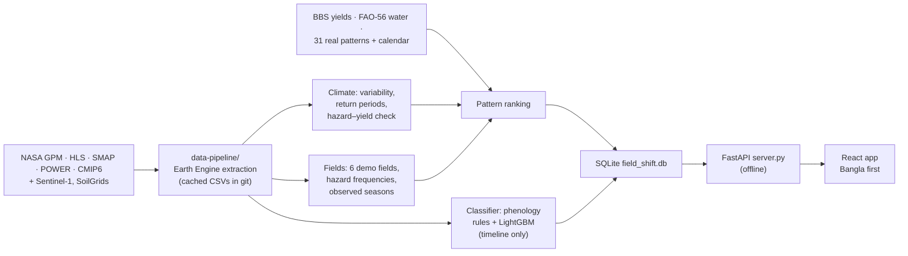

# Field Shift — should a Feni farmer keep, adjust or shift their crop rotation?


NASA Space Apps Challenge 2026, **"Field Shift: Adapting Farms with NASA Data"**.

A farmer in Feni, Bangladesh, asks one question: *should I keep my crop rotation, adjust one season, or shift
to a different pattern?* Field Shift answers it in Bangla (and English) for a field picked on a map, ranking
real Feni cropping patterns on food, water and the hazards that field's own satellite record shows. Rain comes
from NASA GPM IMERG, crop seasons and flooding from NASA HLS and Sentinel-1, soil water from NASA SMAP,
temperature from NASA POWER and the future from NASA NEX-GDDP-CMIP6.

**Docs index:** [docs/README.md](docs/README.md) · **Demo script:** [docs/demo-script.md](docs/demo-script.md)

---

## 1. The problem, and why Feni

* **August 2024.** Flash floods breached the Muhuri embankments in Fulgazi and Parshuram. BBS reports 55 % of Feni's Aman crop
  damaged and 97 % of its Aman seedbeds; Feni's Aman area fell from 66,130 ha (2023-24) to 26,753 ha (2024-25)
  and production from 205,436 t to 84,659 t (BBS *Yearbook of Agricultural Statistics 2025*, Tables 3.5 and
  4.2.9). We checked those units against two earlier Yearbooks and a DAE field report before using them
  ([bbs-aman-area-check.md](docs/methodology/bbs-aman-area-check.md)).
* **One district, three climates.** The coast (Sonagazi) faces the Bay of Bengal; the north (Fulgazi,
  Parshuram) sits on the flash-flood Muhuri; the middle is double- and triple-cropped rice land.
* **Real patterns only.** The ranking chooses among 31 annual cropping patterns recorded in the Chittagong
  agricultural region (Shahidullah et al. 2017), checked against the DAE BAMIS crop calendar
  (sowing and harvest windows, turnaround). No invented crop permutations.

## 2. Validation results — including what failed

Each claim was tested against something the model did not see. Failures are reported, not tuned away.

| Test | Result | Verdict |
|---|---|---|
| **Sentinel-1 flood extent vs the BBS damage table** (Aug–Sep 2024, excess over 2023) | Feni +32 / Noakhali +24 percentage points of Aman cropland under water → ratio **1.33**; BBS damage 55 % / 44 % → **1.25** (all cropland pixels: 1.32) | ✅ Matches the official ranking and ratio |
| **T. Aman "flood-size downpour"** (7-day GPM rain ≥ 5-year return level) vs BBS Feni Aman production, 2011–2024 | **−29 % production, p = 0.008** (exact permutation, local anomaly); without 2024 still −8 to −10 %, p ≈ 0.05 (2 years) | ✅ Linked to lost harvest |
| **Boro heat at flowering** (≥ 35 °C in the flowering week, 16 of 27 years) vs BBS Boro yield | **−0.5 % yield, p = 0.79**; production +1 %, p = 0.78 | ❌ Not linked. Relabelled **exposure, not damage**; threshold **not** tuned |
| **Coastal vs inland dry season** (phenology rules on HLS + Sentinel-1) | Sonagazi: no dry-season crop in **9 of 9** readable years; five inland fields: fallow in **0 of 32** | ✅ Drives the ranking as feasibility (salinity **not** measured) |
| **Crop classifier** (LightGBM, 1,200 points, train ≤ 2022 / test 2024) vs BBS Aman area | Reproduces its rule labels (test macro F1 0.977) but sees Feni Aman 2024/2023 = **0.99** against BBS **0.40** | ❌ **Failed.** Phenology rules cannot tell a flooded-then-regreened field from a harvested one, and the monsoon classes are only T. Aman / Fallow. Used for the season timeline only, **never in the ranking** |
| **NASA POWER rainfall** | 1984–96 mean 1,280 mm, 1997–2025 2,778 mm: a **+117 % discontinuity** (Pettitt break) | ❌ Rejected for rain |
| **GPM IMERG vs the BMD Feni gauge** (annual, 2016–2024) | r = **0.95** (POWER 0.77); GPM reads about 13 % low; no break in any GPM rain indicator (48 of 48) | ✅ Used for all rain |

Details: [hazard-yield check](docs/methodology/climate-shift.md#8-what-the-climate-does-to-your-crops-frequencies-not-slopes),
[classifier model card](docs/ml/crop_classifier.md), [field risk](docs/methodology/field-risk.md),
[phenology rules](docs/methodology/phenology.md).

### What the six demo fields get (default priorities, current pattern Boro – Fallow – T. Aman)

| Field | Readable / cropped dry seasons | Climate risk of current pattern | Top pick | Main hazard in the record |
|---|---|---|---|---|
| Daganbhuiyan | 8 / 8 | 0.14 | Mustard – Boro – T. Aman | flowering heat (exposure only) |
| Chhagalnaiya | 2 / 2 | 0.19 | Mustard – Boro – T. Aman | flowering heat (exposure only); dry soil for T. Aman 3 of 12 years |
| Feni Sadar | 8 / 8 | 0.20 | Mustard – Boro – T. Aman | flowering heat (exposure only); Boro window under water 1 of 9 |
| Parshuram | 5 / 5 | 0.21 | Mustard – Boro – T. Aman | dry soil for T. Aman 4 of 12 years |
| Fulgazi (Muhuri) | 9 / 9 | 0.31 | Mustard – Boro – T. Aman | dry soil for T. Aman 4 of 12; T. Aman under water 1 of 10 (2024) |
| **Sonagazi (coast)** | **9 / 0** | **0.85** | **Fallow – Aus – T. Aman** | no dry-season crop 9 of 9; T. Aman under water 5 of 10 |

Mustard – Boro – T. Aman wins inland on food and water, not on lower risk; the app says so in its "Why?" line.

### Climate the farmer plans for (Feni Sadar, GPM 1998–2025)

* Monsoon rain swings 16 % a year: 1,386 mm (2022) to 2,508 mm (2017).
* **2024: 550 mm in 7 days**, the largest in 28 years (about once in 56 years on a Gumbel fit; 28 years cannot
  pin that down).
* T. Aman was hit by a flood-size 7-day downpour (≥ 408 mm) in 4 of 28 years: 2004, 2017, 2019, 2024.
* **CMIP6, 10 models, 2041–2060 vs 1998–2014 observed** (delta change, projections not forecasts):
  hot days (≥ 35 °C) in March–May 45 → 60 (SSP2-4.5; models 47–70) and 64 (SSP5-8.5; 48–70); wettest 5 days
  +1 % and +4 %, with models disagreeing on the sign.

## 3. What the farmer sees

* **Map picker** (Leaflet + OpenStreetMap) with six demo fields, one per upazila. Tapping elsewhere selects
  the nearest demo field and says how far away it is.
* **Verdict card:** Keep / Adjust / Shift, one sentence in Bangla, the current pattern and the top 3 with food
  (t rice-equivalent/ha), irrigation (mm) and a **"Why?"** line quoting the field's own record, e.g.
  *"Radar shows this field under water for 15 days or more during T. Aman in N of the last M years."*
* Patterns a field cannot carry are listed below the ranking with the reason
  (*"No dry-season crop observed on this field in 9 of 9 readable years"*).
* Behind closed toggles: what the climate does to each crop (frequencies, return periods, the 2024 flood at
  the Fulgazi field), CMIP6 projections, the season-by-season satellite timeline, field conditions and
  technical details.

## 4. NASA data used

| Product | Earth Engine / API ID | Period used | Used for |
|---|---|---|---|
| GPM IMERG V07 half-hourly | `NASA/GPM_L3/IMERG_V07` | 1998-01-01 – 2026-11-07 (upazilas); 2015– (fields, points) | All rainfall: variability, return periods, crop-hazard counts, classifier features |
| HLS Landsat 30 m v2.0 | `NASA/HLS/HLSL30/v002` | 2015-02 – 2026-10 | NDVI / EVI / LSWI (Fmask-cleaned) for phenology and classifier |
| HLS Sentinel-2 30 m v2.0 | `NASA/HLS/HLSS30/v002` | 2015-12 – 2026-10 | as above |
| SMAP L4 v8 | `NASA/SMAP/SPL4SMGP/008` | 2015-03-31 – 2026-11-05 | Root-zone moisture: dry-soil hazard, classifier features |
| MODIS MOD13Q1 v6.1 | `MODIS/061/MOD13Q1` | 2015 – 2026 | 16-day NDVI / EVI at the demo fields |
| MODIS MOD11A2 v6.1 | `MODIS/061/MOD11A2` | 2015 – 2026 | Land-surface temperature at the demo fields |
| NASA POWER daily (AG) | `power.larc.nasa.gov/api/temporal/daily/point` | 1984 – 2026; temperature from 1998 | Tmax (bias-corrected to BMD Feni), ET0 (FAO-56) |
| NEX-GDDP-CMIP6 | `NASA/GDDP-CMIP6` | 1995–2014, 2041–2060; SSP2-4.5, SSP5-8.5; 10 GCMs | Delta-change projections: hot days, wettest 5 days |
| ECOSTRESS, GRACE / GRACE-FO, SMAP, MODIS (monthly) | see [data-sources.md](docs/data-sources.md) | 2019-01 – 2024-09 | "Field conditions" panel for the original test plot |

Other data: Copernicus Sentinel-1 GRD (`COPERNICUS/S1_GRD`), ESA WorldCover v200, JRC Global Surface Water
1.4, ISRIC SoilGrids 2.0, FAO GAUL 2025, BBS Yearbooks 2013–2025 (yields, areas, flood damage, BMD Feni
rain and temperature), DAE BAMIS / BRRI / BARI crop calendars, FAO-56, FAOSTAT food balance sheets, FCT
Bangladesh. Every source with table and page: [docs/data-sources.md](docs/data-sources.md).

## 5. Method



1. **Extraction** (`data-pipeline/climate/`, `fields/`, `classifier/`). Earth Engine reads; outputs are cached
   CSVs committed to the repo, so nothing downstream needs Earth Engine.
2. **Climate** (`climate/climate_shift.py`, `climate_extremes.py`, `climate_projections.py`). Trend tests
   (Mann-Kendall, Sen, Pettitt) are kept but no trend is significant over 28 years, so the app reports
   *frequencies*: how often each crop's own calendar window was hit. Each hazard is checked against BBS
   yields (`hazard_yield_check.py`); unlinked ones are shown as exposure only.
3. **Demo fields** (`fields/select_fields.py`). Six 90 m squares of pure WorldCover cropland, chosen by rule:
   coastal Sonagazi, flood-hit Fulgazi (29 m from the Muhuri), the others nearest each upazila centre.
4. **Field risk** (`server.py`, [field-risk.md](docs/methodology/field-risk.md)). From each field's own record:
   inundation (Sentinel-1, ≥ 15 days for rice), dry soil (SMAP on the field's soil, FAO-56 depletion),
   flowering heat, dry seasons left fallow. A season never seen cropped (≥ 5 readable years) makes the
   patterns that need it infeasible on that field.
5. **Ranking** (`server.py`). Food (BBS Feni yields × food energy × share eaten by people), water
   (FAO-56 Kc × Penman-Monteith ET0, effective rainfall), soil and diversity, and the field's climate risk,
   weighted by the farmer's priorities. Growing less food can never look like a win.
6. **Classifier** (`classifier/`). Rule labels → 10-day features → LightGBM. Fills the satellite timeline
   only (see the failed check above).

## 6. Limitations

* **One district, six demo fields.** The fields are 90 m squares chosen by rule from satellite cropland maps,
  not surveyed farms. A tapped location uses the nearest demo field.
* **28-year rain record.** Mann-Kendall has little power over 1998–2025; "no significant trend" is not
  evidence of no change. Return levels beyond about 30 years are orders of magnitude.
* **Rule-derived labels.** No hand-labelled ground truth. The classifier learns the rules, so its F1 measures
  agreement with them, not crop accuracy.
* **Radar thresholds set by eye** on the six demo fields (−19 dB flooding, +4 dB canopy rise in 10-day means;
  15 days of standing water for a rice flood). The 1,200 training points are separate, but the demo-field
  timelines are not fully independent of those choices.
* **IMERG 2014 inhomogeneity.** IMERG switches from TRMM-era to GPM-era inputs in mid-2014 (Huffman 2019,
  *Caveats for IMERG in the TRMM Era*). Heavy-rain and dry-spell counts shift there; they carry a caveat and
  are kept out of trend advice.
* **2015 temperature step.** NASA POWER Tmax steps down around 2015 (a known inhomogeneity, not investigated).
  The bias correction rests on 22 months of BMD Feni data (2023–24). One baseline, 1998–2014, is used for
  projections.
* **No salinity measured.** Sonagazi's empty dry seasons are what salinity would cause; we only observe the
  empty field.
* **BBS yields from one year** (2024-25) drive the food score; the hazard-yield check uses 2011–2025 but only
  one district. BBS land-use and crop-area tables disagree (Aman exceeds net cropped area in four districts).
* **Same first choice inland.** The five inland fields share a top pick; only coastal Sonagazi differs.
* **No cost or income** in the ranking yet. Soil and diversity scores still use hand-set crop priors.
* **Map tiles need internet**; the data and API run offline.

## 7. Run it

Requires Python 3.13 and Node 22.12+ (tested with Node 24). The SQLite database (`backend/offline/field_shift.db`) is in the repo,
so no Earth Engine account is needed to run the app or the tests.

```bash
git clone -b improve/feni-v2 https://github.com/Zishan-125/field-shift.git
cd field-shift

# Backend (offline API on port 8001)
cd backend
python -m venv .venv
.venv\Scripts\activate                 # Windows;  source .venv/bin/activate on Linux/macOS
pip install -r requirements-offline.txt
cd offline
uvicorn server:app --port 8001         # check: http://127.0.0.1:8001/api/offline/health

# Frontend (new terminal)
cd frontend-web
npm ci
npm run dev                            # http://localhost:5173 (API URL: VITE_API_BASE_URL, default 127.0.0.1:8001)

# Tests (backend venv active)
cd data-pipeline
python -m pytest
```

Rebuilding the data needs an Earth Engine Cloud project (`EE_PROJECT=<id>`). The order is in
[docs/methodology/climate-shift.md](docs/methodology/climate-shift.md#9-reproduce) and the headers of each
script; tables are reloaded with `backend/offline/build_*_tables.py`.

### Repository map

| Path | What |
|---|---|
| `backend/offline/` | The API the app calls (`server.py`) and the SQLite builders |
| `frontend-web/` | React 19 + TypeScript + Vite app (`src/pages/Dashboard.tsx`, `src/components/farmer/`) |
| `data-pipeline/` | Extraction, climate, fields, classifier, patterns, scoring; tests in `data-pipeline/tests/` |
| `data-pipeline/reference/` | Sourced inputs: crop calendar, patterns, BBS tables, food energy, fields |
| `docs/` | Methodology, model card, data sources and gaps |
| `archive/` | Earlier design and synthetic-data experiments, kept for history ([archive/README.md](archive/README.md)) |

### Deployment

The frontend is built by Vercel from this repository. Production (`field-shift-five.vercel.app`) deploys the
`Zishan-backend-ml-models-data-pipeline` branch; every push to `improve/feni-v2` gets a Vercel preview.
The app needs the FastAPI server above; point `VITE_API_BASE_URL` at it.

## License

MIT — see [LICENSE](LICENSE). Data products keep their own licences (NASA open data; Copernicus Sentinel
data; ESA WorldCover CC BY 4.0; SoilGrids CC BY 4.0; BBS publications).
